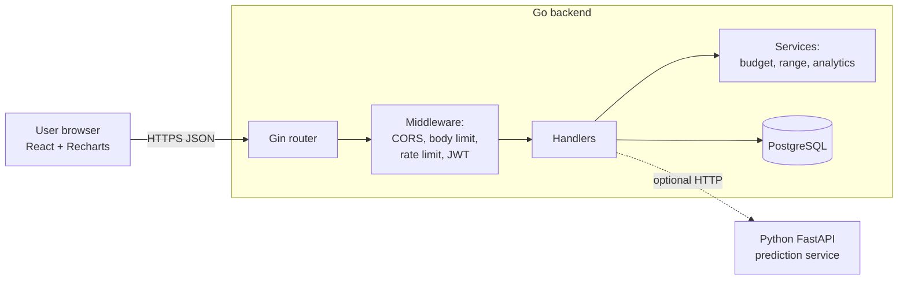
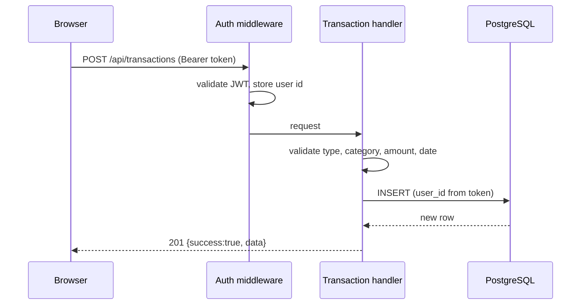
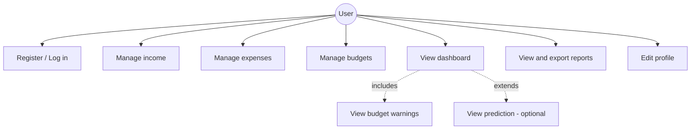
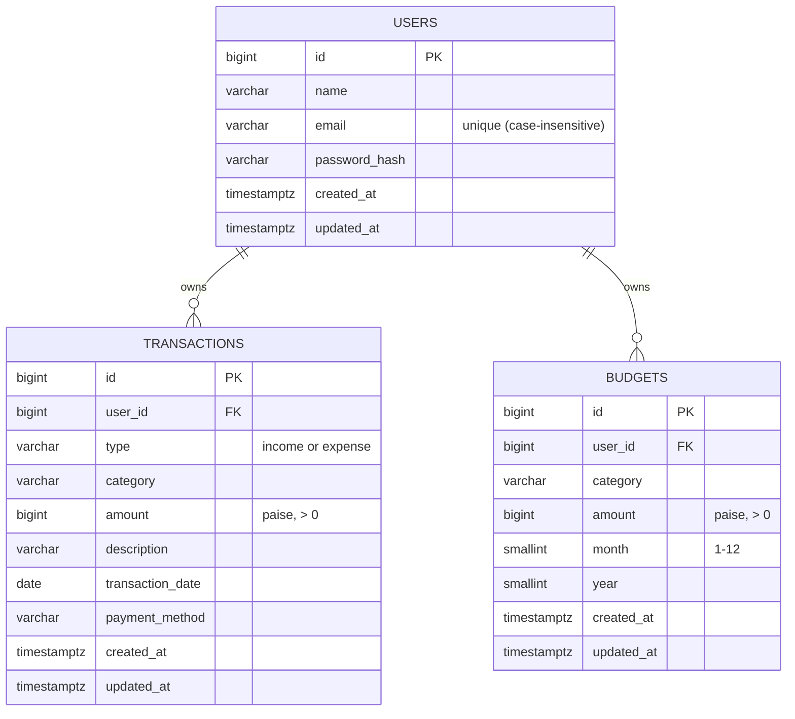

# Smart Personal Finance and Expense Tracker — Capstone Report

*Course: ENSP465 — New Age Programming Languages Lab · Language: Go (Golang)*
*Student: [Name] · Roll No: [Roll Number] · Faculty: Dr. Hemraj Kumawat*

> This report describes the application **as implemented in the source code**. Items that were written but not yet run are marked "Not yet executed" in the testing report (section 11). Complete that table with your own results before submitting.

## 1. Abstract
The Smart Personal Finance and Expense Tracker is a web application that helps individuals record income and expenses, set monthly category budgets, monitor savings and view interactive charts and reports. The backend is written in Go with the Gin framework and stores data in PostgreSQL. A React front end shows the dashboard. Security features include bcrypt password hashing, JWT authentication, per-user data isolation, input validation and rate limiting. An optional Python service estimates next month's expenses; the main application works without it.

## 2. Problem Statement
Digital payments make spending easy but scatter records across bank messages and apps. Users cannot easily see where money goes, whether they are within budget, or how much they save. Spreadsheets need manual effort and commercial apps may store data on third-party servers. A simple, private, self-hosted tool is needed.

## 3. Objectives
1. Secure registration and login with hashed passwords and token authentication.
2. CRUD for income and expense records with categories, search, filters, sorting and pagination.
3. Monthly budgets per category with live spending, remaining amount and warnings.
4. Dashboard and reports calculated from real stored data, with CSV export and print layout.
5. Exact money handling (no floating-point errors).
6. Automated tests for the important logic.
7. (Optional) Expense prediction that never blocks the core application.

## 4. Existing and Proposed System
| | Existing (spreadsheets / many commercial apps) | Proposed |
|---|---|---|
| Data entry | manual formulas or linking to third parties | simple forms with validation |
| Budget warnings | none or paid | built in, 80 % and 100 % thresholds |
| Privacy | data may live on external servers | own PostgreSQL database |
| Insight | history only | charts, savings rate, growth, optional estimate |
| Cost | often subscription | free, open technology stack |

## 5. Requirements
### 5.1 Functional
| ID | Requirement |
|---|---|
| FR1 | Register, log in, log out; duplicate e-mails rejected |
| FR2 | Add / view / edit / delete income with category, description, date |
| FR3 | Add / view / edit / delete expenses with category, payment method, description, date |
| FR4 | Search, filter, sort and paginate transactions |
| FR5 | Create / edit / delete monthly budgets; no duplicates per category and month |
| FR6 | Show spent, remaining, utilization and warnings for budgets |
| FR7 | Dashboard summary cards, charts, recent transactions, date filters |
| FR8 | Reports: monthly, category-wise, daily, budget performance, CSV export, print |
| FR9 | Analytics: highest category, average daily spend, growth, savings rate, comparison with previous period |
| FR10 | Optional expense prediction with disclaimer |

### 5.2 Non-functional
| ID | Requirement |
|---|---|
| NFR1 | Security: bcrypt, JWT, parameterised SQL, CORS allow-list, rate limit, body limit |
| NFR2 | Privacy: users can access only their own records |
| NFR3 | Accuracy: money stored as integer paise |
| NFR4 | Usability: responsive layout, loading, empty and error states, confirmations |
| NFR5 | Maintainability: layered code, migrations, tests, documentation |
| NFR6 | Resilience: core features work when the ML service is down |
| NFR7 | Performance target: typical list/dashboard queries answered within ~200 ms for thousands of records (indexes on user/date/category) — *not yet measured* |

## 6. System Architecture

Layers: **presentation** (React pages/components), **API** (Gin routes + middleware), **business logic** (`internal/services`, pure functions with unit tests), **data** (GORM/SQL against PostgreSQL, schema created by migrations). Note: instead of a separate repositories package, handlers use GORM and parameterised SQL directly; the calculation rules are isolated in `services` so they can be tested without a database.

### Request flow — adding an expense

## 7. Use Cases

| Use case | Main flow | Alternative / error flows |
|---|---|---|
| Register | User enters name, e-mail, password → account created → logged in | e-mail exists (409); weak password / invalid e-mail (400 with field messages) |
| Log in | Enter credentials → token issued → dashboard | wrong credentials (401); too many attempts (429) |
| Add expense | Open form → fill fields → save → appears in list and dashboard | invalid amount/date/category (field errors); session expired → login |
| Create budget | Choose month, category, limit → saved → progress bar shows spending | duplicate budget (409) |
| View dashboard | Choose date range → summary, charts, budgets, recent items | no data → empty state; server down → error banner with retry |
| Export report | Choose range → Export CSV → file downloads | empty range → CSV with header only |

## 8. Database Schema

* Foreign keys use `ON DELETE CASCADE` (deleting a user removes their data).
* Indexes: `(user_id, transaction_date)`, `(user_id, type, category)`, unique `LOWER(email)`.
* Constraints: `CHECK (type IN ('income','expense'))`, `CHECK (amount > 0)`, `UNIQUE (user_id, category, month, year)` on budgets.
* Migrations: `backend/migrations/001_create_tables.sql`, applied automatically and recorded in `schema_migrations`.

## 9. API Documentation
See `docs/API.md` (all endpoints, parameters and examples) and the Postman collection in `postman/`.

## 10. Implementation Notes
* **Money**: the `money.Money` type (int64 paise) parses text like `"12.5"` exactly, rejects more than 2 decimals/negatives/exponents, and prints `12.50`.
* **Budget maths** (`internal/services/analytics.go`): `Remaining = Budget − Spent`; `Utilization = Spent ÷ Budget × 100`; status thresholds 80 % / 100 %.
* **Date ranges**: presets and custom ranges are resolved on the server (`ResolveRange`); the previous period has the same length as the selected one.
* **Dashboard**: totals, category shares, trends and growth are computed by SQL aggregates over the signed-in user's rows.
* **Frontend**: reusable components (`Common`, `DateRangeFilter`, `TransactionTable`, `TransactionList`), context providers for auth and toast notifications, and an API client that logs the user out on 401.
* **Optional ML**: `ml-service/predictor.py` (pandas + scikit-learn). Needs ≥ 4 months; linear regression when ≥ 6 months and R² ≥ 0.30, else a 3-month average; never returns negative values.

## 11. Testing Report
Environment note: the code was authored in a sandbox without Go, PostgreSQL or internet access. Only the rows marked **Executed** were actually run there.

| Area | What is tested | Location | Status |
|---|---|---|---|
| Money parsing/formatting | valid/invalid amounts, JSON round-trip | `backend/internal/money` | Not yet executed |
| JWT & passwords | hash, valid/expired/forged/garbage tokens | `backend/internal/auth` | Not yet executed |
| Auth middleware, rate limit | missing/invalid/expired token; 429 after burst | `backend/internal/middleware` | Not yet executed |
| Budget, range, savings calculations | known inputs/outputs, leap year, year boundary, zero division | `backend/internal/services` | Not yet executed |
| API: registration/login | success, duplicate, validation, wrong password, expired token | `backend/tests` | Not yet executed |
| API: transaction CRUD | create/read/update/delete, 404 after delete | `backend/tests` | Not yet executed |
| API: ownership | user B cannot read/update/delete user A's records or budgets; spoofed `user_id` ignored | `backend/tests` | Not yet executed |
| API: invalid input | 12 bad-field cases, bad filters, bad ids, bad budgets | `backend/tests` | Not yet executed |
| API: lists | filters, sort, pagination, search incl. `%` escape | `backend/tests` | Not yet executed |
| API: budgets | spent/remaining/utilization, duplicate 409, edit, delete | `backend/tests` | Not yet executed |
| API: dashboard | known January 2026 data → totals, savings %, average, categories, growth, empty period | `backend/tests` | Not yet executed |
| API: reports/CSV | monthly, categories, daily, range filtering, formula-injection protection | `backend/tests` | Not yet executed |
| Prediction logic | trend, average fallback, short history, bad rows, rollover, gaps | `ml-service/test_predictor.py` | **Executed — 8/8 passed** |
| Frontend helpers | money/date formatting, amount validation | `frontend/src/utils/format.test.js` | **Assertions executed with Node — passed** (Vitest runner itself not run) |
| Manual UI check | every page and form against the running backend | browser | Not yet executed |

**Commands to complete this table:** `go test ./internal/...`, then with `TEST_DATABASE_URL` set `go test ./tests/... -v`, `go vet ./...`, `npm test`, `npm run build`, `python -m unittest -v`. Paste your results here.

## 12. Limitations
* Not yet compiled/run by the author's tooling; expect minor fixes after the first `go build`.
* No password change/reset, e-mail verification or token revocation.
* Single currency (INR); no bank linking, so "net savings" is not a bank balance.
* Alerts appear in the app only (no e-mail/SMS).
* Prediction is a simple statistical estimate.
* No automated browser (end-to-end) tests.

## 13. Future Enhancements
Recurring transactions, multiple accounts and currencies, receipt attachments, e-mail/push alerts, refresh tokens, full Docker deployment, richer forecasting models and a mobile app.

## 14. Conclusion
The project delivers an end-to-end personal finance tracker in Go with a clear layered design, exact money handling, security-conscious defaults and documented tests. After running the verification commands and fixing any issues found, it is ready for demonstration and viva.

## 15. Viva Questions and Answers
See `docs/VIVA_QA.md`.

## 16. References
1. Go documentation — https://go.dev/doc/
2. Gin Web Framework — https://gin-gonic.com/docs/
3. GORM — https://gorm.io/docs/
4. PostgreSQL documentation — https://www.postgresql.org/docs/
5. RFC 7519, JSON Web Token (JWT)
6. React — https://react.dev ; Recharts — https://recharts.org
7. scikit-learn — Pedregosa et al., JMLR 12, 2011
